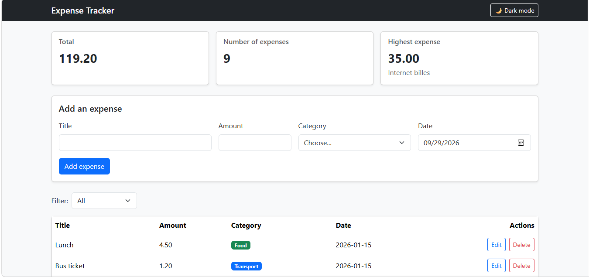
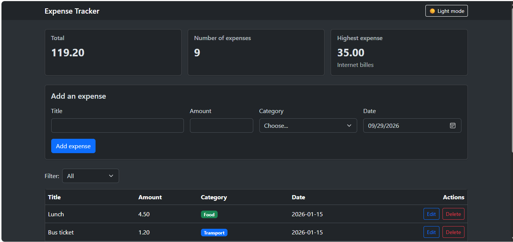
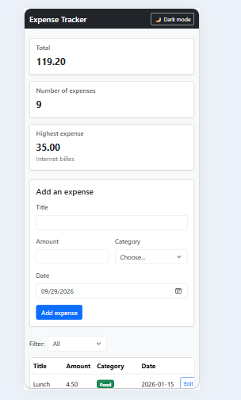

# Expense Tracker

تطبيق ويب بسجّل فيه مصاريفي الشخصية: بضيف مصروف (العنوان، المبلغ، التصنيف، التاريخ)، وبشوف كل مصاريفي بجدول، وبفلترها حسب التصنيف، وبعدّلها وبحذفها، وبيطلعلي الإجمالي والعدد وأعلى مصروف مباشرة. البيانات محفوظة بقاعدة بيانات PostgreSQL، عن طريق backend مبني بـ Node.js و Express، والواجهة بتحكي معه عن طريق API.

## الأدوات
- **Frontend:** HTML و CSS و JavaScript و Bootstrap 5
- **Backend:** Node.js و Express، مع مكتبات `pg` و `cors` و `dotenv`
- **Database:** PostgreSQL
- **الاختبار:** Thunder Client

## هيكل المشروع

```
expense-tracker/
├── backend/
│   ├── server.js        (الـ API كامل)
│   ├── schema.sql       (جدول expenses وبيانات تجريبية)
│   ├── package.json
│   └── .env.example     (شكل ملف الإعدادات، بدون كلمة السر)
├── frontend/
│   ├── index.html       (هيكل الصفحة)
│   ├── css/style.css    (CSS Grid لكروت الملخص)
│   └── js/app.js        (كل منطق الواجهة والاتصال بالـ API)
├── screenshots/
└── README.md
```

---

## How to run

المطلوب على الجهاز: Node.js و PostgreSQL (مع pgAdmin) و VS Code مع extension اسمها Live Server.

**Backend**

1. من pgAdmin، إنشاء database فاضية اسمها `expense_tracker`.
2. فتح Query Tool عليها، وتشغيل ملف `backend/schema.sql` (بيعمل جدول `expenses` وبيضيف 8 مصاريف تجريبية).
3. جوا مجلد `backend`، نسخ ملف `.env.example` لملف جديد اسمه `.env`، وكتابة كلمة سر PostgreSQL مكان `your_password_here`.
4. فتح terminal جوا مجلد `backend` وتنفيذ:

```
   npm install
   node server.js
```

5. لازم يطلع `Server is running on http://localhost:3000`، ويضل الـ terminal مفتوح.

**Frontend**

1. التأكد إنه الـ backend شغال.
2. فتح `frontend/index.html` بـ Live Server (كليك يمين على الملف ← Open with Live Server).
3. الصفحة بتجيب المصاريف من الـ API مباشرة.

---

## Features

- [x] إضافة مصروف، مع validation بالواجهة (رسالة تحت كل حقل) وبالسيرفر (400 مع رسالة)
- [x] حذف مصروف (مع رسالة تأكيد قبل الحذف)
- [x] تعديل مصروف بـ modal معبّى بالبيانات الحالية
- [x] فلترة حسب التصنيف، مع خيار "All"
- [x] كروت الملخص: الإجمالي، والعدد، وأعلى مصروف (بتنحسب من كل المصاريف، مش المفلترة)
- [x] البيانات محفوظة بقاعدة بيانات PostgreSQL
- [x] Spinner أثناء التحميل، و alert واضح لأي خطأ (حتى لو السيرفر طافي)
- [x] الصفحة Responsive على الموبايل، وكروت الملخص بـ CSS Grid
- [x] **Bonus:** Dark mode، وبيتذكّر اختيار المستخدم

## الـ API

| Method | Path | الوظيفة | نجاح | أخطاء |
|---|---|---|---|---|
| GET | `/api/expenses` | كل المصاريف | 200 | — |
| GET | `/api/expenses/:id` | مصروف واحد | 200 | 404 |
| POST | `/api/expenses` | إضافة مصروف | 201 | 400 |
| PUT | `/api/expenses/:id` | تعديل مصروف | 200 | 400, 404 |
| DELETE | `/api/expenses/:id` | حذف مصروف | 200 | 404 |

كل الاستعلامات مكتوبة بـ parameters (`$1` و `$2`...) للحماية من SQL Injection، وكلمة سر الـ database موجودة بملف `.env` ما بينرفع ولا بيتسلّم.

---

## Screenshots

**الوضع الفاتح (Light mode):**



**الوضع الغامق (Dark mode):**



**الموبايل:**



---

## What was the hardest part?

أصعب شي واجهته كان إنه السيرفر يرد عليّ بالكود القديم بعد ما أعدّل. كنت أعدّل `server.js` وأجرب، والنتيجة ما تتغير، وما كنت فاهم ليش. بالآخر اكتشفت إنه كان في سيرفر قديم لسا شغال بـ terminal ثاني وماسك port 3000، فالسيرفر الجديد ما كان يقدر يشتغل أصلاً. حليتها بإني وقفت كل عمليات Node، وعدّلت `app.listen` بحيث يطبع الخطأ إذا السيرفر ما قدر يشتغل (مثل `EADDRINUSE`)، وصرت أتأكد دائماً إنه في سيرفر واحد بس شغال.

وكمان واجهت مشكلة إنه مكتبة `pg` بترجع المبلغ كنص (`"4.50"`) والتاريخ كـ Date ممكن يتزحزح يوم بسبب فرق التوقيت. حليتها بالـ SELECT نفسه: `amount::float8` عشان يرجع رقم، و `to_char(date, 'YYYY-MM-DD')` عشان يرجع التاريخ نص ثابت.

ما سلّمت مجلد `node_modules` لأنه بيرجع بـ `npm install`، وما سلّمت ملف `.env` لأنه فيه كلمة سر الـ database.
